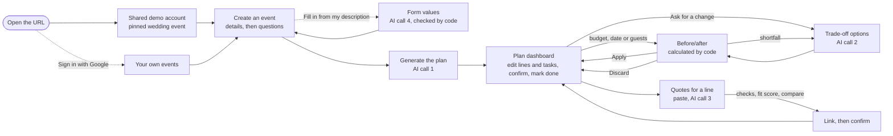
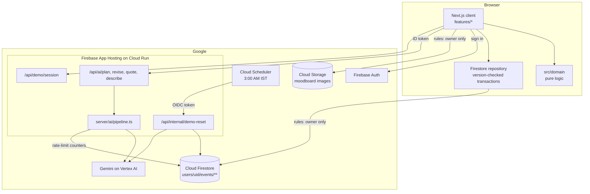

# Architecture

How PlanCraft is put together. The requirements are in [the spec](../3.%20Product-specification-v3-mvp.md), mainly §7 (AI) and §8 (architecture).

## User flow



Each AI step has a fallback that needs no AI: an empty plan with categories only; the change calculated by code, which can still be applied; or entering the quote by hand.

## System



- **The browser writes the user's own data directly**, through the Firestore client SDK, guarded by the security rules. Every plan write is a transaction that checks the stored `version` and increments it (EM-62). The server never writes a user's events.
- **The server reads a user's plan** only for `/api/ai/revise`, and always the plan of the verified token's own user ID.
- **Only the reset route writes demo data** on the server side.

## Layers

| Layer | Folder | Rule |
|---|---|---|
| Routes | `src/app` | Pages, layouts and route handlers only. No logic |
| Screens | `src/features/*` | One folder per screen. They call the domain and the repository |
| Domain | `src/domain` | **Pure and deterministic.** No React, Next, Firebase, `fetch` or I/O (a lint rule enforces this). "Today" is passed in. Carries the 90% coverage gate |
| Data | `src/data` | The `Repository` interface, with an in-memory version for tests and a Firestore version for the app |
| Server | `src/server` | The AI pipeline, providers, prompts and contracts; rate limits; ID-token and OIDC checks; env validation; CSP |
| Firebase | `src/lib/firebase` | Client set-up, auth helpers and the moodboard's Storage calls. The SDKs are loaded lazily to keep the first load small (ENG-11) |

## Data model

The Zod schemas in [src/domain/schemas.ts](../src/domain/schemas.ts) and [src/domain/quote.ts](../src/domain/quote.ts) are the source of truth.

```
users/{uid}/events/{eventId}                      EventPlan: lines, tasks and the pending proposal embedded
users/{uid}/events/{eventId}/quotes/{quoteId}     Quote: pasted text, the AI extraction or manual entry, note
Storage: users/{uid}/events/{eventId}/moodboard/{imageId}   image, with its alt text as metadata
usage/**                                          rate-limit counters (server only, TTL on expiresAt)
demo/state                                        last reset and the pinned demo event (server only)
```

- **Money** is stored as integer minor units, using the currency's ISO 4217 exponent.
- **Dates** are `YYYY-MM-DD` with no time or time zone.
- **Never stored, always calculated on read:** remaining budget, percentages, deadlines, task statuses, alerts, quote checks and the fit score.

**The invariants** are checked by property tests in [tests/property/invariants.test.ts](../tests/property/invariants.test.ts):

- Σ line amounts + remaining = budget.
- Per-guest amount = unit cost × guests.
- Confirmed lines never change through AI or recalculation.
- There are no dependency loops.
- Apply checks everything on a copy.
- Discard leaves the plan exactly as it was.

## The AI pipeline

[src/server/ai/pipeline.ts](../src/server/ai/pipeline.ts) runs the same steps for all four calls:

1. Verify the Firebase ID token.
2. Check the rate limits. They're counted in Firestore, so they hold across instances.
3. Check the request with Zod. Bodies are capped at 100 KB.
4. Build the prompt. Internal IDs become short references (`L1`, `T1`), and untrusted text goes inside delimiters.
5. Call Gemini in JSON mode with a response schema generated from the Zod contract, with a timeout.
6. Validate the output with Zod and the rule functions (P1–P8, R1–R8, Q1–Q5).
7. If that fails, make one repair attempt that names the failed rule IDs.
8. Return `{ ok, data }` or `{ ok: false, error: { code, message, retryable } }`.

Logs hold the call, error code, attempts and failed rule IDs only. They never hold user or AI text.

**Providers:** `VertexProvider` is used in the app. `FixtureProvider` serves `tests/fixtures/ai/` for tests and is refused when `NODE_ENV=production` (AI-05).

## Shared demo account

| What | How |
|---|---|
| Sign-in | `/` calls `POST /api/demo/session`, which mints a custom token for the fixed user `demo-shared`. There is no password, and the account is never linked to Google |
| Collisions | Version-checked writes and live updates. A stale edit is refused with a notice, never silently lost (EM-62) |
| Reset | Cloud Scheduler calls the reset route nightly. It wipes the demo, writes the seed inputs (inputs only, no plan) and the sample quotes, then generates the plan with live Gemini through the same validation as any user (EM-63) |
| Limits | AI requests are counted per IP (10 a minute, 50 a day) and capped at 1,500 a day for the demo in total. The account can't upload moodboard images |
